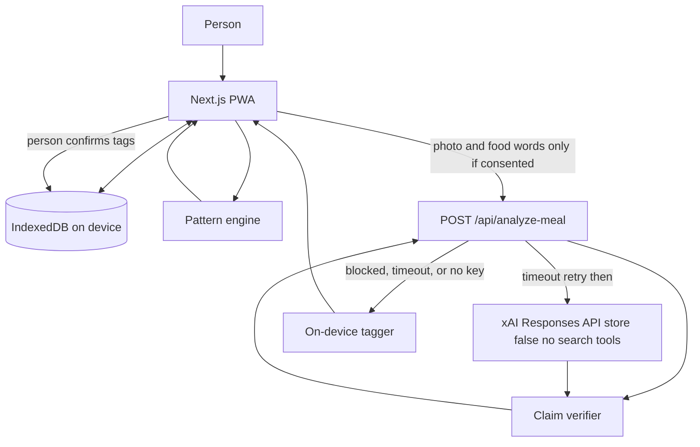

# Harbor architecture

Harbor is a Next.js (App Router) and TypeScript progressive web app. The journal is the source of truth on the device. A server route exists only to call the xAI API with a meal photo after consent. There is no account server and no database in the cloud.

## Boundaries

| Data | Where it lives | Leaves the device? |
| --- | --- | --- |
| Meals, symptoms, flares, notes | IndexedDB | Only if the person exports a file |
| Sleep, steps, resting heart rate | IndexedDB, source `simulated` | No |
| Meal photo | IndexedDB after confirm, size-capped | Only the analyze request, after consent |
| Name, conditions, symptoms | Not included in the AI request | No |
| API key | Server environment, never the browser bundle | Used only as the Authorization header |

The analyze route reads `consent`, `imageDataUrl`, and `description`. Other JSON fields are ignored. Food words that look like health details are dropped before the prompt is built. The request body sets `store: false`, omits tools, and does not enable web search or X search. xAI documents that image requests should not be stored, and that stored Responses are otherwise kept for 30 days. Confirm the current docs before submission. See `docs/AI_DISCLOSURE.md`.

## Pattern engine

`src/lib/pattern-engine.ts` is deterministic and has no network. It runs in the browser on the open journal.

- Food tags: confirmed meals in the 48 hours before a flare mark, compared with meals outside those windows. A tag is described only if it appears before at least two flares, in at least half of the pre-flare meals, and clearly more often than on other days.
- Sleep, steps, and resting heart rate: the flare date and the day before, compared with other days. Thresholds are in the source and covered by tests.
- Stress: check-ins in the 24 hours before the flare mark, not counting the flare mark itself.
- A gentle check-in appears when recent days resemble a pattern already found, and no flare was marked in the last 18 hours. The wording says it is not a prediction.

Every generated paragraph passes `reviewCopy`. The standard clinician line is attached separately. Unsafe model text is discarded.

## Self-healing

`src/lib/resilience.ts` retries a failed operation once, then returns a fallback. The meal call uses a 12 second timeout per attempt. If Grok does not answer, the reply is unsafe, or no API key is set, the on-device tagger uses the typed food words. The Status page can practice both a recovered failure and a full outage without contacting xAI. Opening IndexedDB is retried once. Repair is a person-triggered rebuild that puts back entries it can still read.

## Installable web app, then phones

`public/manifest.webmanifest` and `public/sw.js` make a production build installable. The service worker is registered only in production so local development does not get stuck on a stale shell. API routes are not cached.

Phase 2 path: add Capacitor, point `webDir` at the Next.js static or hosted build, and ship the same UI to iOS and Android. Keep IndexedDB inside the WebView for the journal until a native storage review says otherwise. Do not send the journal to a new backend as part of that wrap. Real wearable and sensor connections, if added, stay behind a separate consent and must remain labeled until they are real.

The challenge allows either iOS or Android in Phase 1 and expects both in Phase 2. A responsive PWA plus Capacitor is the planned way to meet that without a second codebase.

## Tests

`npm test` runs Vitest in Node. Tests inject a fake `fetch` or avoid fetch entirely. They do not call xAI or any other network. They cover the claim verifier, de-identified prompts, retries, the on-device tagger, Avery’s patterns, and the visit summary.

## Main files

- `src/app/` — screens and the two API routes
- `src/lib/analyze-meal.ts` — consent, timeout, retry, fallback
- `src/lib/pattern-engine.ts` — personal patterns and the gentle check-in
- `src/lib/safety.ts` — claim verifier
- `src/lib/demo-persona.ts` — Avery Chen, synthetic
- `src/lib/db.ts` — IndexedDB
- `src/components/` — shell, provider, citations
